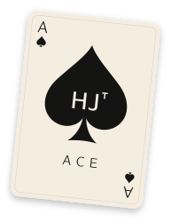
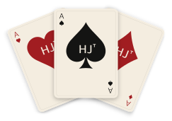

<p align="center">
  
</p>

# Transformers Converge to Invariant Algorithmic Cores

[NeurIPS 2026](https://neurips.cc/virtual/2026/poster/151845) · [arXiv:2602.22600](https://arxiv.org/abs/2602.22600)

Code for the paper by Joshua S. Schiffman. Algorithmic Core Extraction (ACE) finds compact subspaces of a trained
transformer that are necessary and sufficient for a task, compares them across independently trained models, and
mechanistically interprets them. The experiments cover a Markov chain, modular addition (including a theory of
grokking time), and subject–verb agreement and indirect object identification (IOI) in six language models: GPT-2
Small, Medium and Large, LLaMA-3.1-8B, Gemma-2-9B and Qwen2.5-32B.

## Installation

```bash
python -m pip install -e .
```

Python 3.10 or later. The Markov, modular-addition and grokking experiments run on a laptop. The language-model
experiments need a GPU for the larger models; the IOI runs used `transformers` 4.49.0. LLaMA and Gemma are gated
on Hugging Face and need an access token (`HF_TOKEN`).

> [!TIP]
> **Apply ACE to your own network.** Pass `ace` the activations at a layer and the rest of the network
> from that layer on. It returns an orthonormal basis of the core, which you can then test by keeping
> only the core or removing it:
>
> ```python
> from cores.extraction import ace
> from cores.ablations import SubspaceAblationHook
>
> H = model[:2](X).detach()          # activations after model[1], shape (N, D)
> Q, r = ace(H, lambda: model[2:])   # the core: an orthonormal basis, shape (D, r)
>
> # sufficient: keeping only the core preserves accuracy; necessary: removing it destroys it
> for mode in ("keep", "remove"):
>     hook = model[1].register_forward_hook(SubspaceAblationHook(Q, mode))
>     print(mode, (model(X).argmax(-1) == y).float().mean().item())
>     hook.remove()
> ```
>
> [`examples/quickstart.py`](examples/quickstart.py) runs this end to end on a CPU in a few seconds. On a
> task whose answer depends on two directions of the input, ACE finds a two-dimensional core out of 64:
> keeping only the core leaves accuracy close to the model's, and removing it drops accuracy to chance.
> For language models, `ace_from_matrices` takes the covariance of the activations and the average of
> JᵀJ directly; `src/cores/SVA_uni.py` and `src/cores/ioi_core.py` show how to build them.

## Figures and tables

| Paper | Script |
|---|---|
| Fig. 1 | `markov.py`, then `paper_figures/markov_fig1.py` |
| Figs. 2–3 | `modadd.py`, then `paper_figures/modadd_figs.py` |
| Fig. 4 | `grok_sweep_two_layer.py` |
| Fig. 5 | `sva.py`, then `paper_figures/sva_fig5.py` |
| Fig. 6 | `generation_outputs.txt` in each `sva.py` run folder |
| Fig. 7, Figs. A14–A15, Tables A8–A11 | `src/cores/ioi/` (see [Two-site cores](#two-site-cores)) |
| Table A7, Figs. A12–A13 | `src/cores/ioi_core.py` (see [Single-site cores](#single-site-cores)) |
| Figs. A1–A3, A5–A9, A12–A13 | `supplement/appendix_figs.py` (see [Appendix controls](#appendix-controls)) |
| Fig. A4 | `supplement/plot_mod_add_clock_seeds.py` |
| Fig. A10 | `grok_sweep.py` |
| Fig. A11 | `supplement/grok_mechanism_control.py`, then `supplement/plot_grok_data_size.py` |

## Markov chain

```bash
python markov.py
```

Writes `experiments/markov_chain/results/plots/Markov_fig.pdf`.

## Modular addition

```bash
python modadd.py            # train, analyze and plot (python modadd.py --quick for a short check)
```

Writes `experiments/modular_addition/mod_add_fig1.pdf` and `mod_add_fig2.pdf`.

## Grokking sweeps

```bash
python grok_sweep_two_layer.py   # Fig. 4: two-layer transformers, 12 seeds per setting
python grok_sweep.py             # Fig. A10: one-layer transformers
```

Both scripts sweep weight decay at p = 53 and the modulus at weight decay 1, and fit the grokking-delay law. Add
`quick` to run 3 seeds per setting. Outputs are written to `experiments/grok_sweep_two_layer/` and
`experiments/grok_sweep/`.

## Subject–verb agreement

```bash
python sva.py quick         # GPT-2 Small, Medium and Large, with layer sweeps, and the combined plot
python sva.py run --model-name meta-llama/Llama-3.1-8B --run-name llama31 --seed 0 --run-layer-sweep
python sva.py run --model-name google/gemma-2-9b --run-name gemma2 --seed 0 --run-layer-sweep
python sva.py run --model-name Qwen/Qwen2.5-32B --run-name qwen25_32b --seed 0 --run-layer-sweep
```

Each run writes to `experiments/sva/<run name>/`, with logs in `experiments/sva/logs/`. The controls in the appendix
(prompts where subject and attractor number vary independently, and the baseline directions) come from
`src/cores/SVA_uni_controls.py`, which extends `SVA_uni.py`; its saved runs are in `experiments/sva/*_mixed/`:

```bash
python src/cores/SVA_uni_controls.py --model-name gpt2 --attractor-mode mixed --baselines --run-layer-sweep --exclude-final-layer --run-name gpt2_mixed
```

## Indirect object identification

### Single-site cores

One core per model at the final token. All six models were run with `ioi_core.py` on the same prompts, built from
the names that are single tokens in every tokenizer (`src/cores/experiments/ioi_all/shared_names.json`):

```bash
export PYTHONPATH=src:src/cores
NAMES=$(python -c "import json; print(','.join(json.load(open('src/cores/experiments/ioi_all/shared_names.json'))))")
python src/cores/ioi_core.py --model-name gpt2 --out-dir src/cores/experiments/ioi_all/gpt2 --names "$NAMES" \
    --n-samples 1200 --batch-size 64 --n-jac 128 --dtype float32 --fast-sweep --probe-rank 12 --top-k 2 \
    --coarse-frac 0.5 --rank-max 32 --rank-fine 12 --rank-stride 2 --rank-rule causal --causal-tol 0.02 \
    --keep-tol 0.02 --baselines --state-operator
```

| Model | `--out-dir` (in `src/cores/experiments/ioi_all/`) | `--dtype` | `--batch-size` | `--top-k` |
|---|---|---|---|---|
| `gpt2` | `gpt2` | float32 | 64 | 2 |
| `gpt2-medium` | `gpt2medium` | float32 | 48 | 2 |
| `gpt2-large` | `gpt2large` | float32 | 32 | 2 |
| `meta-llama/Llama-3.1-8B` | `llama318b` | bfloat16 | 8 | 4 |
| `google/gemma-2-9b` | `gemma29b` | bfloat16 | 8 | 4 |
| `Qwen/Qwen2.5-32B` | `qwen2532b` | bfloat16 | 8 | 4 |

For Qwen2.5-32B, run `src/cores/ioi_core_frozen.py` with the same arguments, on a GPU with at least 80 GB. It runs
`ioi_core.py` unchanged but does not store gradients for the weights, which would otherwise take about 60 GiB.

From the saved runs, without a GPU:

```bash
python src/cores/ioi_cross_model.py --skip-runs --out-root src/cores/experiments/ioi_all \
    --models gpt2 gpt2-medium gpt2-large meta-llama/Llama-3.1-8B google/gemma-2-9b Qwen/Qwen2.5-32B
python src/cores/ioi_single_layer_tables.py --root src/cores/experiments/ioi_all
```

The first command computes the cross-model alignment of the cores (Fig. A8C). The second rebuilds Table A7 and
Fig. A8C–D from the saved runs and checks them, and the single-site numbers quoted in the text, against the paper.

### Two-site cores

Cores at the repeated name (S2) and the final token (END), and the reduced linear model that links them, in
`src/cores/ioi/`. `notebooks/ioi.ipynb` runs the GPU steps for all six models on Colab, saving under `results/ioi/`:

| Step | Script | Output |
|---|---|---|
| Sweep, scan and test: the layers and ranks of the core | `golden.py` | `golden/<model>/<model>.json`, core bases |
| The prompts of Wang et al. (2022) | `wang.py` | `golden/<model>/<model>_wang.json` |
| Per-prompt data for the reduced model | `model_dump.py` | `model/<model>/<model>_dump.npz` |
| PCA of the activations and a random subspace | `controls.py` | `model/<model>/<model>_controls.json` |
| ACE against PCA, random, difference of means and unembedding on the Wang et al. prompts (GPT-2 models) | `wang_controls.py` | `wang_controls_<model>.json` |

The rest needs no GPU and loads no model:

```bash
export PYTHONPATH=src
python -m cores.ioi.figures --out figures      # Fig. 7, Figs. A14–A15
python -m cores.ioi.tables --out tables        # Tables A8–A11
python -m cores.ioi.reduced_model --dumps results/ioi/model --out results/ioi/reduced_model.json
```

The reduced model needs the per-prompt data and core bases (about 4 GB), which are too large for this repository:
running `notebooks/ioi.ipynb` writes them under `results/ioi/`, and `--dumps` points to them if they are elsewhere.
It also downloads each model's tokenizer to match prompts across models, which needs `HF_TOKEN` for LLaMA and Gemma.

`results/ioi/` holds the saved results and run logs. They came from these steps run in separate passes: the first
sweep skipped S2 at layers from END's reference layer on and END at layers up to S2's (added by
`<model>_fill.json`); the size search at the lowest-removal layers in the GPT-2 models ran as a second pass
(`extra_*` logs, merged into `<model>.json`); and the controls ran separately (`<model>_controls.json`, which also
holds an earlier transport measure that the paper does not use). GPT-2 Small rerun through this code reproduces its
saved results; the other five models have not been rerun in this layout.

`common.py` holds the shared code, `data/` the sentence frames and name pool, and `frames/` the frame filtering.

## Appendix controls

`supplement/` holds the controls added for the appendix and their saved results. Run the experiment scripts from
`supplement/`; `appendix_figs.py` then draws the figures from the saved evidence in `supplement/outputs/`.

| Figure | Experiment | Evidence | Plot |
|---|---|---|---|
| A1–A2: Markov null controls and energy | `markov_*.py` | `prepare_markov_*.py` | `appendix_figs.py` |
| A3: modular-addition necessity and sufficiency by prefix | `modadd_nec_suf_prefix.py` | | `appendix_figs.py` |
| A4: modular-addition clocks for the other seeds | checkpoints from `modadd.py` | | `plot_mod_add_clock_seeds.py` |
| A5: cross-model alignment of the agreement cores | `sva.py` runs (values from the original submission's appendix table) | | `appendix_figs.py` |
| A6–A8, A13: SVA and IOI controls and nulls | `src/cores/SVA_uni_controls.py`, `src/cores/ioi_core.py` | `prepare_sva_ioi_control_figures.py`, `prepare_llm_null_ladders.py` | `appendix_figs.py` |
| A9: Jacobian sample count | `sva_jacobian_robustness.py` | | `appendix_figs.py` |
| A11: grokking data-size control | `grok_mechanism_control.py` | | `plot_grok_data_size.py` |
| A12: single-site IOI core | `src/cores/ioi_core.py` | | `appendix_figs.py` |

## Main-text figures as laid out in the paper

The plotting scripts in `src/cores/plot_*.py` draw the figures as first submitted. `paper_figures/` draws the same
plots with the paper's layout; data and analysis are unchanged. Run the experiments above first, then, from the
repository root with `PYTHONPATH=src`:

```bash
python paper_figures/markov_fig1.py --out paper_figures/figures/markov_fig1.pdf
M=experiments/modular_addition
python paper_figures/modadd_figs.py --run-dir-wd1 $M/ckpts/wd1 --run-dir-wd0 $M/ckpts/wd0 --prefix-dir $M/ckpts/wd1 \
    --core-npz-wd1 $M/results/wd1_res/core_formation.npz --core-npz-wd0 $M/results/wd0_res/core_formation.npz \
    --mode-npz-wd1 $M/results/wd1_res/mode_spread.npz --mode-npz-wd0 $M/results/wd0_res/mode_spread.npz
S=experiments/sva
python paper_figures/sva_fig5.py $S/gpt2small $S/gpt2med $S/gpt2large $S/llama31 $S/gemma2 $S/qwen25_32b
```

## Citation

```bibtex
@inproceedings{schiffman2026transformers,
  title     = {Transformers Converge to Invariant Algorithmic Cores},
  author    = {Schiffman, Joshua S.},
  booktitle = {Advances in Neural Information Processing Systems},
  year      = {2026}
}
```

## License

MIT; see `LICENSE`.

<p align="center">
  
</p>
